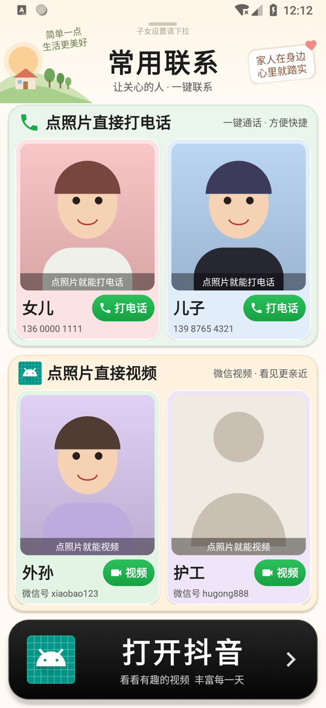
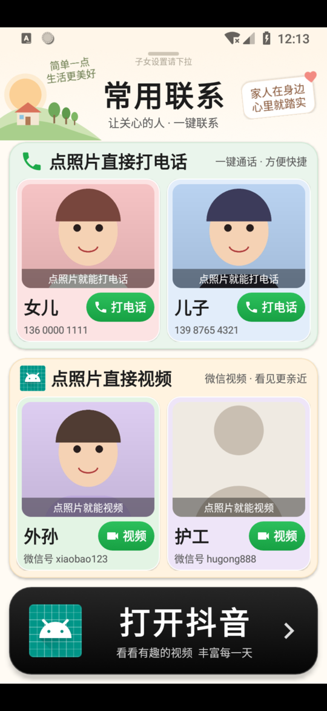

# 常用联系 · ElderLauncher

> 专为**不太识字、或者容易误触**的老人设计的安卓"极简桌面"。
> 点头像就能打电话、点头像就能打微信视频，点一下就能看抖音；**熄屏再亮屏，自动回到这个页面**，等于一键重置，再也不怕点乱了。
>
> 本产品完全免费，由大鼻子狗开发。

<p align="center">
  
  
</p>

## 它解决什么问题

老人用智能手机，最常见的麻烦是：看不懂字、找不到按钮、误触之后不知道怎么退回来。本应用把手机变成只有三件事的"傻瓜界面"：

- **点头像打电话**：两位常用联系人，点大照片直接拨号。
- **点头像打微信视频**：两位常用联系人，点大照片自动完成"打开微信 → 找到联系人 → 发起视频通话"。
- **点一下看抖音**：底部一个大按钮直接进入抖音。
- **熄屏即重置**：不管老人停在哪个页面（微信、抖音、设置、拨号盘……），只要熄屏再亮屏，就自动回到本页面；同时**杀掉抖音后台**，下次重新进入。误触了？按一下电源键就好。
- **自动开到最大音量**：打电话、打视频、打开抖音之前，都会先把通话/媒体/铃声音量调到最大，打电话时同时打开免提，方便听力不好的老人。

## 面向子女的配置

- 第一次进入由子女配置：两个电话号码、两个微信联系人（微信号/备注）、每人一张照片、称呼、管理 PIN。
- 从老人页**下拉页头**并输入 PIN 才能进入配置页，老人不容易误入。
- 手机没有微信/抖音时会提示并跳转到应用商店，登录由子女完成。
- 微信界面在不同机型/版本上差别很大，如果自动找不到搜索按钮，可在配置页使用**"教一次"**：子女示范点一遍，之后自动重放。
- 可随时切换到"正常手机模式"（不再作为桌面），需要时再切回老人模式。
- 配置页带自检与诊断信息导出，便于排查问题。

## 安装使用

1. 到 [Releases](../../releases) 下载 APK（或自行编译，见下文），在手机上安装。
2. 打开应用，按提示：授予电话权限、开启"无障碍服务"（用于熄屏重置、微信自动化、杀抖音后台）、把本应用设为默认桌面、允许忽略电池优化。
3. 填写联系人并保存，切到老人页即可交给老人。

> 国产手机（华为/小米/OPPO/vivo 等）请在系统设置里允许本应用"自启动 / 后台运行"，否则熄屏重置可能被系统限制。

## 从源码构建

项目**不依赖 Gradle**，纯 Java + Android SDK 命令行工具，一个脚本完成。

需要：JDK 8+、Android SDK build-tools（含 `aapt2 / d8 / zipalign / apksigner / core-lambda-stubs.jar`）、`android.jar`（API 35）。

```bash
export BT=$HOME/android-sdk/build-tools/35.0.0
export PLAT=$HOME/android-sdk/platforms/android-35/android.jar
./build.sh
# 产物：build/ElderLauncher.apk
```

`build.sh` 会依次：编译资源 → 编译 Java → 运行 `LogicTest` 单元测试（49 项）→ d8 → zipalign → 签名。首次运行会在 `keystore/` 自动生成本地签名密钥（已在 `.gitignore` 中，**不要提交**）。可用 `VERSION_CODE`、`VERSION_NAME`、`KS_PASS` 环境变量覆盖版本与口令。

## 代码结构

| 路径 | 说明 |
|---|---|
| `src/com/elder/launcher/MainActivity.java` | 老人页（大头像、下拉进设置） |
| `.../SetupActivity.java` | 子女配置页 |
| `.../ElderService.java` | 无障碍服务：熄屏重置、微信自动化、"教一次"录制重放、通话音量/免提 |
| `.../Actions.java` | 打电话、微信视频、开抖音、最大音量、模式切换 |
| `.../Logic.java` | 纯逻辑（号码格式、复位规则、结果挑选等），有单元测试 |
| `test/` | `LogicTest` 单元测试 |
| `test-mocks/` | 测试用的假微信/抖音小应用（模拟器上验证流程用） |
| `docs/screenshots/` | 界面截图 |

## 已知限制

- 微信自动化依赖无障碍读取界面，微信大版本改版后可能需要重新"教一次"。
- 不同厂商对后台、无障碍、免提的限制不同，请在目标手机上实测。
- 最低 Android 7.0（API 24）。

## 参与贡献

欢迎 Issue 和 PR，见 [CONTRIBUTING.md](CONTRIBUTING.md)。

## 许可

[MIT](LICENSE)
